# Kiến trúc hệ thống Xe Chuyên Dụng

Tài liệu mô tả hệ thống sau đợt nâng cấp nhiều tài khoản quản trị, rate limit
dùng chung và tách module trang quản trị. Mọi sơ đồ viết bằng Mermaid nên
GitHub hiển thị trực tiếp và được cập nhật cùng mã nguồn.

| Repository                                                                                   | Vai trò                                      |
| -------------------------------------------------------------------------------------------- | -------------------------------------------- |
| [`xechuyendung_project`](https://github.com/NguyenDinhNam28803/xechuyendung_project)               | Next.js 16: website công khai + trang quản trị (BFF) |
| [`xechuyendung_project_server`](https://github.com/NguyenDinhNam28803/xechuyendung_project_server) | NestJS 12 REST API + PostgreSQL              |

Mục lục:

1. [Sơ đồ hệ thống](#1-sơ-đồ-hệ-thống)
2. [Sơ đồ người dùng và phân quyền](#2-sơ-đồ-người-dùng-và-phân-quyền)
3. [Sơ đồ luồng dữ liệu](#3-sơ-đồ-luồng-dữ-liệu)
4. [Các bước nghiệp vụ](#4-các-bước-nghiệp-vụ)
5. [Mô hình dữ liệu](#5-mô-hình-dữ-liệu)

---

## 1. Sơ đồ hệ thống

### 1.1 Kiến trúc tổng thể

Trình duyệt **không bao giờ gọi trực tiếp** NestJS. Next.js đóng vai trò
Backend-for-Frontend (BFF): render trang công khai phía server, nhận form liên
hệ và làm proxy có xác thực cho trang quản trị. Token phiên chỉ nằm trong cookie
`HttpOnly` giữa trình duyệt và Next.js.

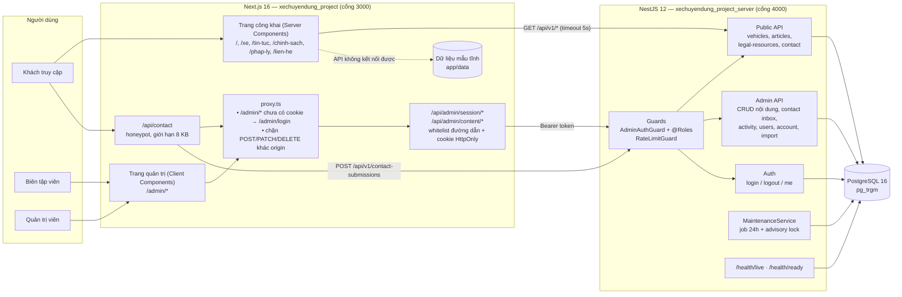

### 1.2 Thành phần NestJS

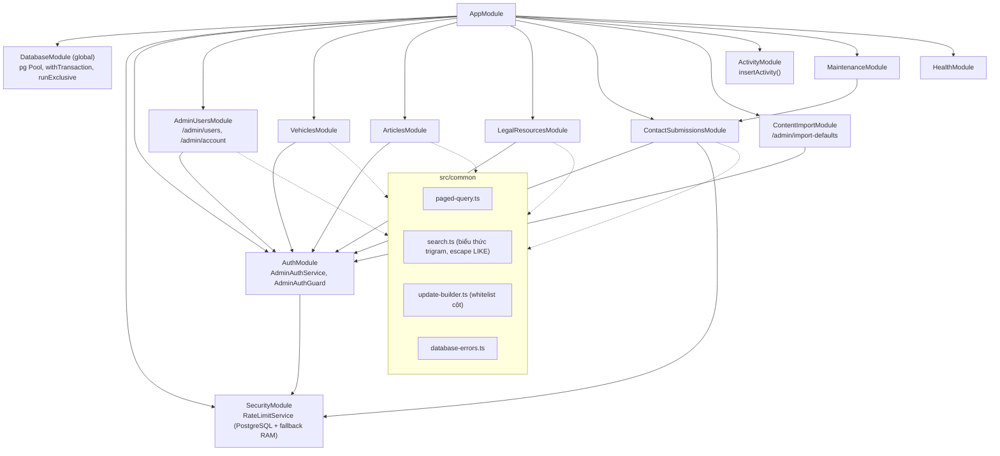

### 1.3 Triển khai

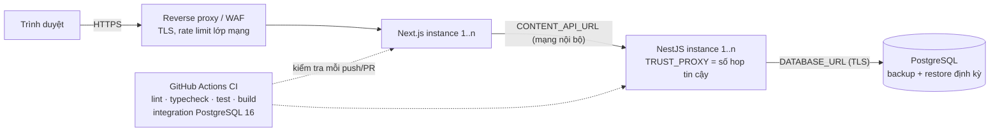

Mọi trạng thái dùng chung (phiên, rate limit, khóa job) nằm trong PostgreSQL,
nên có thể chạy nhiều instance NestJS mà không cần sticky session hay Redis.

---

## 2. Sơ đồ người dùng và phân quyền

### 2.1 Tác nhân và chức năng (use case)

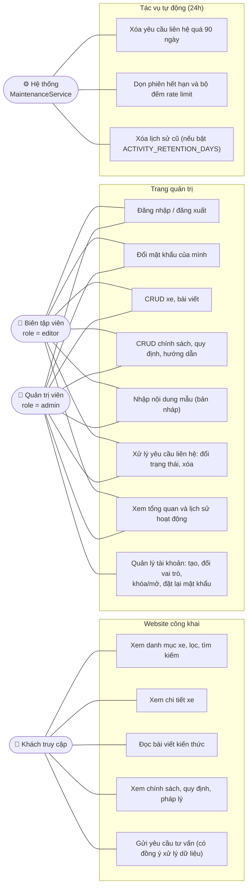

### 2.2 Ma trận quyền

| Chức năng                                    | Khách | Editor | Admin | Kiểm soát ở                         |
| -------------------------------------------- | :---: | :----: | :---: | ----------------------------------- |
| Xem nội dung đã công khai                    |  ✅   |   ✅   |  ✅   | `is_published = TRUE` trong truy vấn |
| Gửi yêu cầu tư vấn                           |  ✅   |   ✅   |  ✅   | Rate limit 10/IP/giờ, honeypot       |
| Đăng nhập, đổi mật khẩu của mình             |   –   |   ✅   |  ✅   | Rate limit 5/IP + 10/tài khoản/15 phút |
| Xem bản nháp, CRUD nội dung, nhập mẫu        |   –   |   ✅   |  ✅   | `AdminAuthGuard`                    |
| Xem/xử lý yêu cầu liên hệ                    |   –   |   ✅   |  ✅   | `AdminAuthGuard`                    |
| Xem lịch sử hoạt động                        |   –   |   ✅   |  ✅   | `AdminAuthGuard`                    |
| Quản lý tài khoản quản trị                   |   –   |   –    |  ✅   | `@Roles('admin')` → 403             |
| Tự khóa / tự đổi vai trò / bỏ admin cuối     |   –   |   –    |  ❌   | Kiểm tra trong `AdminUsersService`  |

---

## 3. Sơ đồ luồng dữ liệu

### 3.1 DFD mức 1

Quy ước: hình chữ nhật bo góc là **tiến trình**, hình trụ là **kho dữ liệu**,
hình chữ nhật là **tác nhân ngoài**.

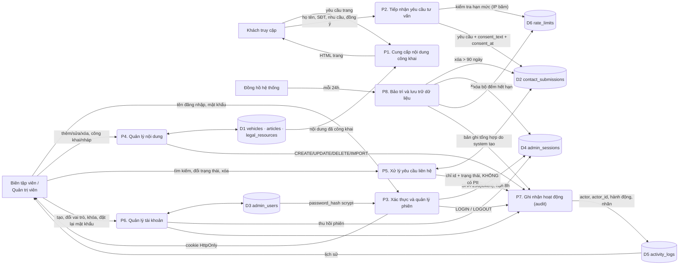

### 3.2 Luồng gửi yêu cầu tư vấn

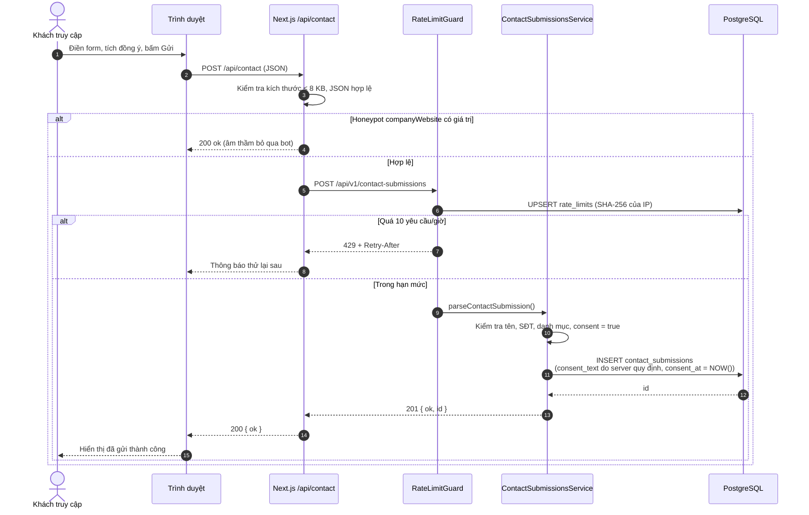

### 3.3 Luồng đăng nhập và một thao tác quản trị

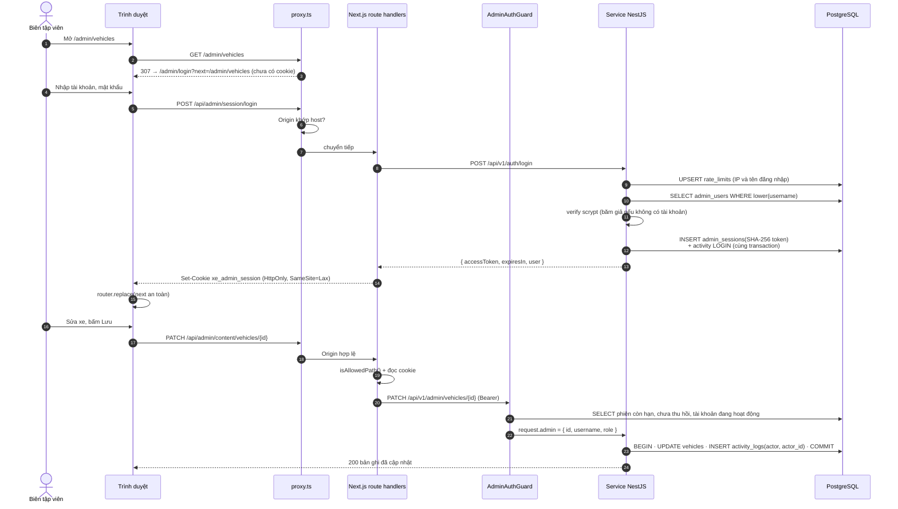

### 3.4 Luồng đọc nội dung công khai (có dự phòng)

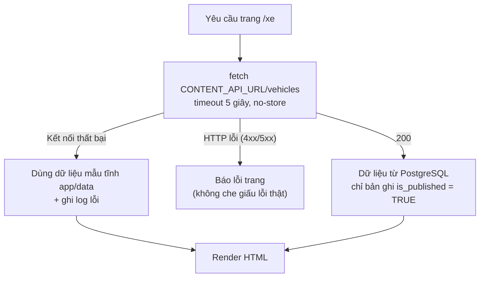

---

## 4. Các bước nghiệp vụ

### 4.1 Quy trình tiếp nhận và xử lý yêu cầu tư vấn

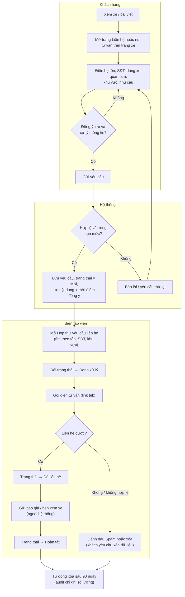

### 4.2 Vòng đời trạng thái yêu cầu liên hệ

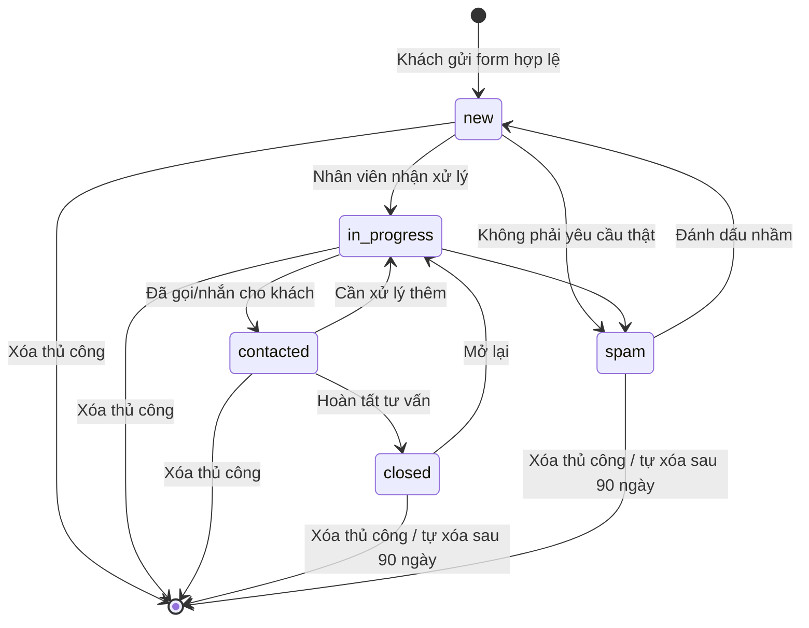

API cho phép chuyển giữa mọi trạng thái; sơ đồ trên là quy trình khuyến nghị.
Mỗi lần đổi trạng thái hoặc xóa đều ghi audit gắn với tài khoản thực hiện,
không kèm tên, số điện thoại hay nội dung tin nhắn.

### 4.3 Quy trình biên tập và xuất bản nội dung

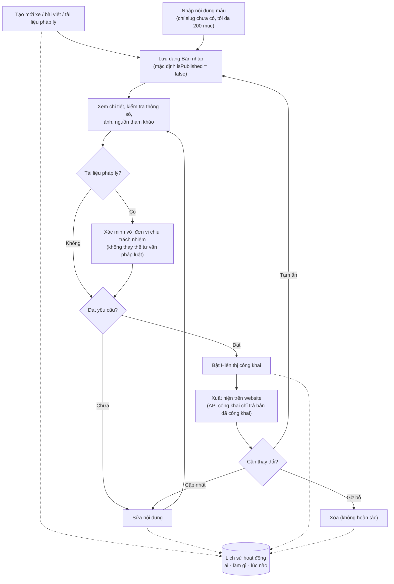

### 4.4 Quản lý tài khoản và phiên đăng nhập

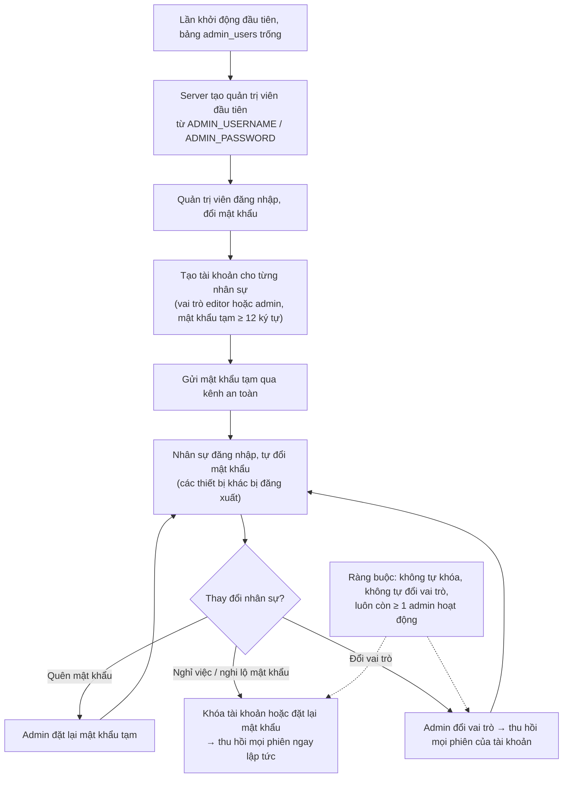

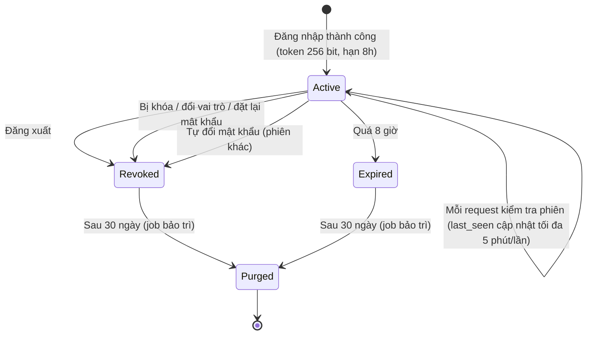

### 4.5 Bảo trì và lưu trữ dữ liệu

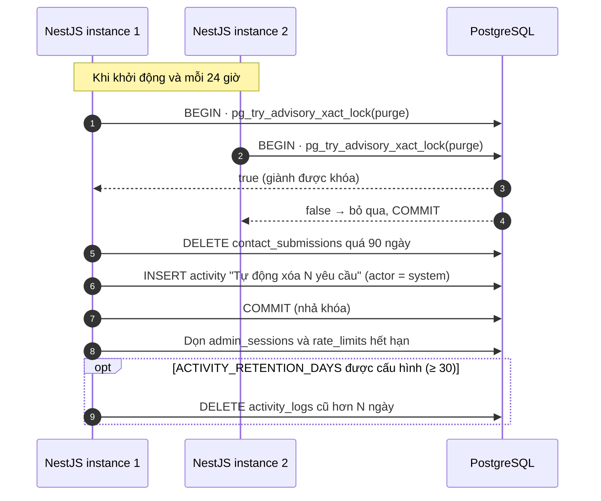

---

## 5. Mô hình dữ liệu

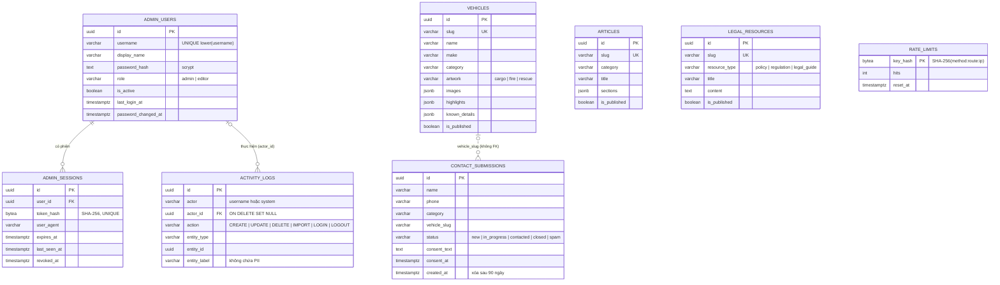

Ghi chú thiết kế:

- `rate_limits` là bảng **UNLOGGED**: ghi nhanh vì không qua WAL; mất bộ đếm
  khi crash/failover là chấp nhận được.
- `contact_submissions.vehicle_slug` cố ý **không có khóa ngoại**: xóa xe không
  làm mất yêu cầu tư vấn đã gửi.
- `activity_logs.actor` giữ tên đăng nhập dạng văn bản để lịch sử vẫn đọc được
  khi tài khoản bị xóa (`actor_id` khi đó thành `NULL`).
- Mọi bảng nội dung có trigger `set_updated_at`; index GIN `pg_trgm` trên biểu
  thức tìm kiếm của từng bảng (migration 006).
